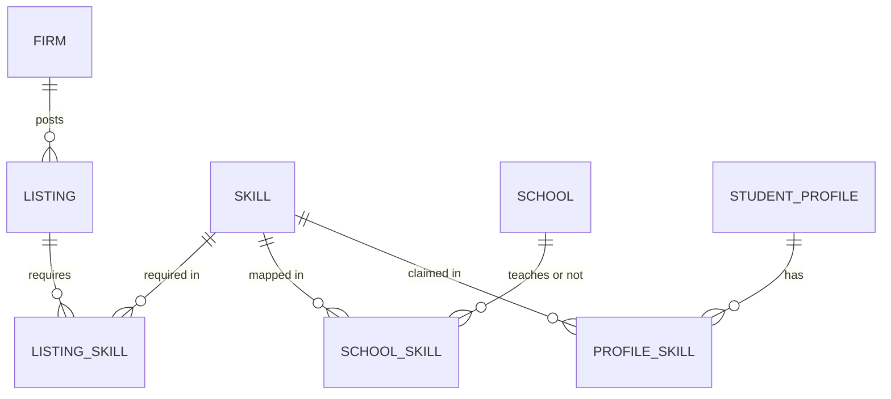

# SkillBridge Kayseri: Database Plan (Week 1)

**Owner:** Yusuf Ulaşlı (back end) · **Reviewers:** Ahmet Safa Açıköz (front end), Esranur Tecik and Edip Emir Altunay (skill list)
**Stack:** Python, Django, SQLite for the pilot (PostgreSQL is possible later)

## 1. Design rules

1. **One shared skill list.** The `Skill` table is the centre of the system. Firm listings, school curriculum and student profiles all point to it. Student view and teacher dashboard read from this same list.
2. **Real vs sample data.** Every table (except usage log) has `data_source` = `real` or `sample`. Pages show a "Sample data" label for any `sample` record. Indicators and the "most wanted skills" ranking use `real` records only.
3. **No personal student data in the pilot.** No name, e-mail, phone, school number, IP address or age is stored. A student profile is an anonymous random code plus a skill selection.
4. **Firm data is entered only after an interview**, and only if the firm agreed that its skill list may be shown. Interview notes in the repo are anonymized.
5. **Simple first.** Only the tables needed for the matching rule, the student view and the teacher dashboard.

## 2. Tables

### Skill (the shared list)
| Field | Type | Note |
|---|---|---|
| id | int PK | |
| name_tr | text | e.g. "TIG kaynağı" |
| name_en | text | e.g. "TIG welding" |
| category | choice | machining, welding, automation, technical_drawing, maintenance, assembly, other |
| description | text | short, concrete (machine, process, material) |
| data_source | choice | real / sample |

### Firm
| Field | Type | Note |
|---|---|---|
| id | int PK | |
| name | text | public only if the firm agrees; otherwise "Firm A" style label |
| sector | choice | e.g. metal products, machinery, automotive parts |
| size | choice | small / medium |
| publish_consent | bool | must be true for real firms to appear |
| data_source | choice | real / sample |
| created_at | datetime | |

### Listing (job or internship)
| Field | Type | Note |
|---|---|---|
| id | int PK | |
| firm | FK → Firm | |
| title | text | e.g. "Entry-level CNC operator" |
| type | choice | internship / entry_level_job |
| description | text | |
| is_active | bool | |
| data_source | choice | real / sample |

### ListingSkill (link table)
| Field | Type | Note |
|---|---|---|
| listing | FK → Listing | |
| skill | FK → Skill | |

Unique on (listing, skill). A listing has the required skills only; there are no optional skills in v1 (keeps the score easy to explain).

### School
| Field | Type | Note |
|---|---|---|
| id | int PK | |
| name | text | vocational school paired with the Kayseri OSB |
| data_source | choice | real / sample |

### SchoolSkill (skill map: needed vs. taught)
| Field | Type | Note |
|---|---|---|
| school | FK → School | |
| skill | FK → Skill | |
| taught | bool | is it in the curriculum/workshop practice? |
| where_taught | text | course or workshop name (optional) |
| workshop_ready | bool | does the workshop have the needed machine? |
| reviewed_with_teacher | bool | confirmed in a teacher meeting |
| data_source | choice | real / sample |

Unique on (school, skill). The skill map = all skills required by real listings, joined with this table.

### StudentProfile (anonymous)
| Field | Type | Note |
|---|---|---|
| id | UUID PK | random code, not linked to a person |
| field_of_study | choice | machining, welding, automation, other |
| created_at | datetime | |

### ProfileSkill (link table)
| Field | Type | Note |
|---|---|---|
| profile | FK → StudentProfile | |
| skill | FK → Skill | |

### UsageLog (anonymized)
| Field | Type | Note |
|---|---|---|
| id | int PK | |
| event | choice | view_student_page, view_dashboard, run_match, etc. |
| timestamp | datetime | |

No user id, no IP address, no user-agent. Used for the "usage logs" output.

### Accounts
Django's built-in `User` is used only for team members and teachers who open the dashboard (adults). Students do not log in during the pilot.

## 3. Relationships



## 4. Matching rule

For one student profile **S** and one active listing **L** with required skills **R(L)**:

```
matched = R(L) ∩ S
missing = R(L) − S
score   = |matched| / |R(L)|
```

Example: firm needs 4 skills, student has 2 → score = 0.5, student sees the 2 missing skills.

- **Ranking:** highest score first. Tie-break 1: more matched skills. Tie-break 2: newer listing.
- **Edge case:** a listing with no required skills is not shown (avoids division by zero).
- **Visibility:** only `is_active` listings; real listings need `Firm.publish_consent = true`. Sample listings are shown with the "Sample data" label.
- **Pilot indicator:** share of students with at least one result with score ≥ 0.5.

```python
def match(profile_skill_ids: set, listing_skill_ids: set):
    if not listing_skill_ids:
        return None
    matched = listing_skill_ids & profile_skill_ids
    missing = listing_skill_ids - profile_skill_ids
    return len(matched) / len(listing_skill_ids), matched, missing
```

## 5. Teacher dashboard queries

- **Most wanted skills:** for each skill, count the number of **distinct real firms** whose active listings require it (counting firms, not listings, so one firm cannot inflate the ranking).
- **Curriculum gap:** skills required by at least one real firm where `SchoolSkill.taught = false` (or no row exists).
- **Skill map count (indicator):** number of entry-level skills with a `taught` value set. Target: at least 15.

## 6. Data protection checklist

- [ ] No personal student fields in any table
- [ ] No IP addresses in logs
- [ ] `data_source` on every content table; "Sample data" label on all templates that show sample records
- [ ] Real data only through admin entry after a firm interview
- [ ] No real firm data or interview notes with names committed to GitHub (use `fixtures/sample_*.json` only)
- [ ] If students under 18 join: consent from student, parent and school first (KVKK)

## 7. Next steps

| Week | Task |
|---|---|
| 1 | This plan reviewed by the team; agree on skill categories and list format with Esranur and Edip |
| 2 | Django project, models and migrations, admin, labelled sample data fixtures |
| 3 | Matching function with unit tests; connect to the student view |
| 4 | Teacher dashboard queries; enter real firm data |

## 8. Open questions

1. Does the OSB-paired school have more than one field (machining, welding, automation)? This decides the `field_of_study` choices.
2. Will firm names be public, or anonymized as "Firm A"? (Ask during interviews.)
3. How do teachers access the dashboard: personal accounts or one shared login for the pilot?
